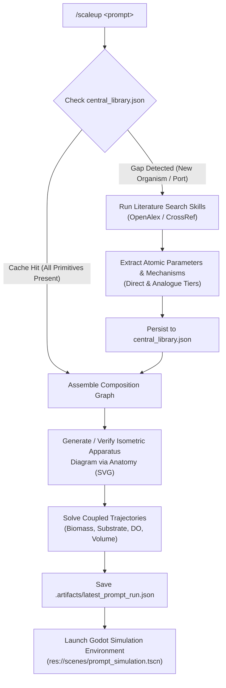

# /scaleup — Unified Literature-to-Simulation Engine

When you run `/scaleup <prompt>`, ScaleUp AI executes an end-to-end bioprocess literature review and simulation pipeline with zero-waste local caching:



## How It Works

1. **Local-First, Research-On-Miss**:
   - Evaluates the user's prompt against `composition/composition/evidence/central_library.json`.
   - If equations, parameters, and biological contexts exist across the 7 indexed core papers (`ganjave2022`, `baez2014`, `lin2000`, `nanchen2006`, `simensen2022`, `zielinski2019`, `morris2011`), the simulation graph is assembled instantly from local disk.

2. **Autonomous Gap Resolution**:
   - If genuine knowledge gaps are flagged (e.g., an unmodeled strain, missing feeding profile, or new organism), the engine invokes `.agents/skills/literature-search/scripts/search_openalex.py` and `search_crossref.py`.
   - Fetched papers are cached to `papers/cached/<id>.json`.
   - Empirical parameters and rate laws are extracted atomically with strict `biological_context` (`DIRECT` vs `ANALOGUE_BRIDGE`) and permanently saved to `central_library.json`.

3. **Anatomy Isometric Apparatus Generation**:
   - Inspects the process mode (batch, fed-batch, continuous) and reactor configuration.
   - Generates or updates an isometric technical vector schematic in `assets/diagrams/bioreactor_isometric.svg` with vessel geometry, Rushton impellers, spargers, probes (pH, DO, temperature), and feed lines.

4. **Interactive Simulation & Hot-Swapping in Godot**:
   - Writes the complete run payload to `.artifacts/latest_prompt_run.json`.
   - Spawns Godot 4.x (`res://scenes/prompt_simulation.tscn -- --run-file .artifacts/latest_prompt_run.json`).
   - The user immediately sees:
     - Real-time 3D vessel visualization & growth curves.
     - The `literature_review_manifest` with paper DOIs, authors, and citations.
     - Strain-bridge badges (`[DIRECT]` vs `[ANALOGUE_BRIDGE]`).
     - Live hot-swap dropdowns to switch competing published mechanisms on the fly.

## Command-Line Usage

Run from repository root:
```bash
# Unified runner with auto-research and Godot auto-launch
python -m composition.runner --prompt "Simulate E. coli fed-batch growth with Ganjave kinetics and Baez overflow metabolism" --auto-research --launch-godot

# Direct tool invocation
python composition/tools/research_to_godot.py --prompt "Simulate fed-batch growth with acetate overflow" --launch-godot
```
